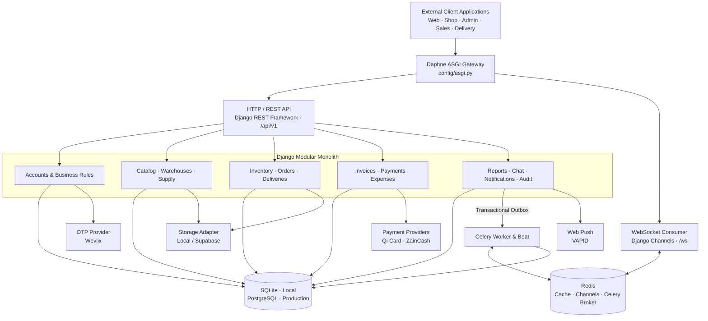
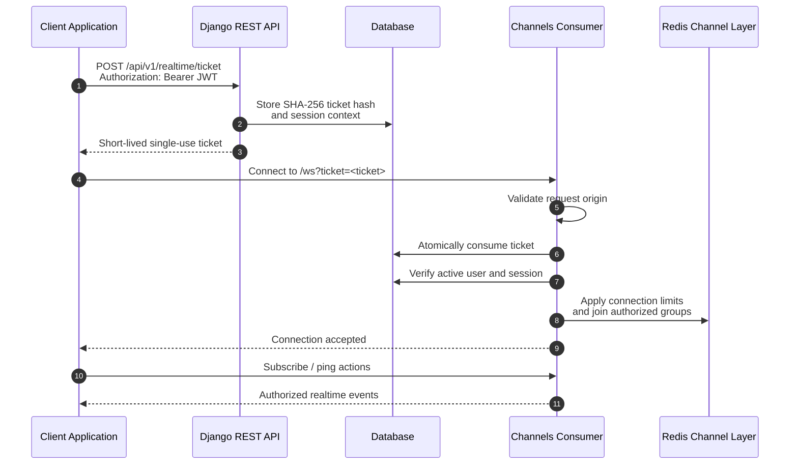

<div align="center">

# AL-NAHRAIN

### Wholesale ERP · Backend API

**Powering the Flow of Wholesale Commerce.**

A modular enterprise backend for wholesale distribution, multi-warehouse operations, order fulfillment, delivery, and financial control — built around reliable business workflows and real-time coordination.

<p>
  <a href="https://www.python.org/"></a>
  <a href="https://www.djangoproject.com/"></a>
  <a href="https://www.django-rest-framework.org/"></a>
  <a href="https://www.postgresql.org/"></a>
  <a href="https://redis.io/"></a>
  <a href="https://docs.celeryq.dev/"></a>
  <a href="https://www.docker.com/"></a>
  <a href="LICENSE"></a>
</p>

<p>
  <strong>Inventory</strong>&nbsp; · &nbsp;<strong>Operations</strong>&nbsp; · &nbsp;<strong>Finance</strong>&nbsp; · &nbsp;<strong>Realtime</strong>
</p>

</div>

---

## Table of Contents

- [1. Project Overview](#1-project-overview)
- [2. Core Capabilities](#2-core-capabilities)
- [3. Technology Stack](#3-technology-stack)
- [4. System Architecture](#4-system-architecture)
- [5. Modular Architecture](#5-modular-architecture)
- [6. Security and Engineering Principles](#6-security-and-engineering-principles)
- [7. REST API](#7-rest-api)
- [8. Realtime Architecture](#8-realtime-architecture)
- [9. Getting Started](#9-getting-started)
- [10. Environment Configuration](#10-environment-configuration)
- [11. Testing and Quality Assurance](#11-testing-and-quality-assurance)
- [12. Deployment and Operations](#12-deployment-and-operations)
- [13. Documentation Hub](#13-documentation-hub)
- [14. License](#14-license)

---

## 1. Project Overview

**Al-Nahrain Wholesale ERP** is a business operations platform for wholesale food distribution. Its backend coordinates the complete operational lifecycle — from supplier purchasing and warehouse inventory to customer orders, delivery confirmation, invoicing, payment allocation, and management reporting.

The system is designed for the people and processes involved in wholesale distribution:

- **Managers** overseeing business rules, approvals, warehouses, and performance.
- **Accountants** managing financial records, payments, expenses, and reconciliation.
- **Warehouse teams** receiving, moving, counting, and preparing stock.
- **Sales and delivery representatives** managing customer activity, orders, collections, and deliveries.
- **Shop customers** placing orders, tracking fulfillment, and reviewing their accounts.

The backend is implemented as a **Django Modular Monolith**: domain responsibilities are separated into focused applications while important business operations remain within consistent database transactions.

### Project at a glance

| Area | Implementation |
| --- | --- |
| Architecture | Django Modular Monolith |
| API | REST API under `/api/v1` |
| Realtime | Django Channels WebSocket endpoint at `/ws` |
| Local database | SQLite |
| Production database | PostgreSQL 15+; Docker Compose uses PostgreSQL 16 |
| Async processing | Celery Worker and Celery Beat |
| Realtime broker / channel layer | Redis in distributed deployments |
| Storage | Local storage or Supabase Storage adapter |
| Domain applications | 22 Django apps |
| External adapters | Storage, Qi Card, ZainCash, Wevlix OTP |

> **Repository scope:** this repository contains the backend. Browser, shop, administration, and representative applications are external clients of its API; the frontend source is not part of this repository.

---

## 2. Core Capabilities

### Business and administration

- Phone-based authentication and session-aware user accounts.
- Role-based access and configurable permission profiles.
- Business settings, advanced operational rules, and change history.
- Custom fields and configurable site settings.
- Append-only audit history for important operations.

### Inventory and supply chain

- Multi-warehouse operations and warehouse-level access scope.
- Product catalog, categories, price tiers, and price history.
- Batch-based inventory with **FEFO** (First Expired, First Out) allocation.
- Supplier purchase orders and inbound goods receipts.
- Weighted-average purchase-cost updates.
- Inter-warehouse transfers with partial receiving and discrepancy review.
- Stocktakes, inventory adjustments, damaged-stock records, and batch traceability.
- Near-expiry and slow-moving stock reporting.

### Sales and customer operations

- Customer onboarding, approval, and shop memberships.
- Multiple shops associated with one account, with active-shop session isolation.
- Customer-specific pricing and account statements.
- Order creation, approval, reservation, and offline-order reconciliation.
- Multi-warehouse order preparation and shipment splitting.
- Vehicle and carrier assignment.
- QR-based delivery dispatch and delivery confirmation.
- Representative GPS updates, customer visits, and reorder workflows.
- Back-in-stock alerts, clearance pricing, and scheduled price changes.

### Financial management

- Delivery-based invoice creation and invoice-line batch traceability.
- Payments with **FIFO** invoice allocation.
- Payment reversals, refunds, credit notes, and returns.
- Qi Card and ZainCash payment-provider adapters.
- Representative collection commissions and monthly close snapshots.
- Expense records and approval workflows.
- IQD / USD exchange-rate history.

### Communication and business intelligence

- Role- and user-scoped notifications.
- WebSocket events for orders, notifications, chat, and location.
- Customer support conversations.
- Durable transactional outbox processing.
- Operational dashboards and sales, debt, inventory, and delivery reports.
- Web Push subscription support.

---

## 3. Technology Stack

| Layer | Technology | Role |
| --- | --- | --- |
| Runtime | Python `3.14` (`>=3.14,<3.15`) | Application runtime |
| Backend framework | Django `5.2.19` LTS | Core application and domain model |
| API | Django REST Framework `3.18.3` | REST endpoints, serializers, and permissions |
| API schema | drf-spectacular `0.30.0` | OpenAPI schema and Swagger UI |
| Authentication | SimpleJWT `5.5.1` + Argon2 | JWT sessions and password hashing |
| ASGI / realtime | Daphne `4.2.3` + Channels `4.3.2` | HTTP ASGI and WebSocket connections |
| Database driver | psycopg `3.3.8` | PostgreSQL connectivity |
| Local database | SQLite | Local development and test workflows |
| Production database | PostgreSQL `15+` | Transactional production persistence |
| Cache / channel layer | Redis server; `redis` client `8.1.0` | Distributed cache, Channels, and broker support |
| Background jobs | Celery `5.7.0` | Asynchronous and scheduled tasks |
| Object storage | Local adapter / Supabase Storage | Product media and private delivery proofs |
| HTTP integrations | HTTPX `0.28.1` | External service communication |
| Image processing | Pillow `13.0.0` | Image validation and processing |
| Cryptography | cryptography `50.0.2` | Fernet field encryption |
| Push notifications | pywebpush `2.5.0` | VAPID-based Web Push |
| Tooling | uv, pytest, pytest-cov, Ruff | Dependency management, testing, coverage, and linting |
| Containers | Docker and Docker Compose | Containerized deployment topology |

Dependency versions are defined in [`pyproject.toml`](pyproject.toml) and locked in [`uv.lock`](uv.lock). The Compose stack uses `postgres:16-alpine` and `redis:7-alpine`; production database and Redis versions should be selected and operated according to the deployment environment.

---

## 4. System Architecture

### 4.1 High-level architecture

The backend exposes HTTP and WebSocket traffic through an ASGI application. REST requests are handled by Django REST Framework, while realtime connections are routed through Django Channels.

Domain applications own business rules and coordinate transactional writes. PostgreSQL is the production database target; SQLite provides a simpler local development and testing path.



**Deployment boundary:** client applications are consumers of this backend, not modules inside this repository. The diagram shows logical integration boundaries; optional providers are only active when configured.

### 4.2 Core business workflow

The platform connects procurement, stock control, fulfillment, delivery, and financial settlement.

```mermaid
flowchart LR
    SUP["Supplier"] --> PO["Purchase Order"]
    PO --> REC["Goods Receipt"]
    REC --> STOCK["Warehouse Inventory<br/>FEFO Batches"]
    STOCK --> ORDER["Customer Order"]
    ORDER --> PREP["Reservation &<br/>Warehouse Preparation"]
    PREP --> DELIVERY["Dispatch & Delivery"]
    DELIVERY --> INVOICE["Invoice"]
    INVOICE --> PAYMENT["Payment & FIFO Allocation"]
    PAYMENT --> REPORTS["Commissions & Reports"]
```



### 4.3 Architectural characteristics

- **Modular monolith:** domain applications have clear responsibilities without introducing distributed transactions between microservices.
- **Service-layer business logic:** views and serializers act as transport adapters; domain services own important business operations.
- **Transactional workflows:** stock deduction, order transitions, payment allocation, and related records are coordinated using database transactions.
- **Database parity:** the ORM and unified PostgreSQL schema are checked by schema synchronization tests.
- **Post-commit events:** realtime and notification events are dispatched after successful database commits, with a durable outbox for retryable delivery.

---

## 5. Modular Architecture

The `apps/` directory contains 22 Django applications grouped by business responsibility.

### Platform, identity, and governance

| Application | Responsibility |
| --- | --- |
| `apps.common` | Shared response envelopes, error codes, phone and date helpers, rounding, idempotency, encryption helpers, health checks, metrics, and demo-data commands |
| `apps.accounts` | Users, JWT authentication, sessions, shop-session isolation, settings, permission profiles, custom fields, OTP flows, and business rules |
| `apps.audit` | Append-only audit records for important business actions |

### Warehousing and procurement

| Application | Responsibility |
| --- | --- |
| `apps.warehouses` | Warehouse records, capacity, coordinates, layout, and warehouse scope |
| `apps.catalog` | Categories, products, price tiers, price changes, and catalog media |
| `apps.supply_orders` | Supplier purchase orders and receipt reconciliation |
| `apps.receipts` | Inbound receipts, receipt lines, weighted-average cost, and batch creation |
| `apps.inventory` | FEFO batches, inventory movements, holds, batch trace, and damaged inventory |
| `apps.transfers` | Inter-warehouse stock transfers, receiving, and discrepancy review |
| `apps.stocktakes` | Stock counts, warehouse locking, and atomic inventory adjustments |

### Customers, orders, and fulfillment

| Application | Responsibility |
| --- | --- |
| `apps.customers` | Customer records, shop memberships, special pricing, statements, and account workflows |
| `apps.orders` | Order lifecycle, pricing rules, approvals, reservations, and multi-warehouse preparation |
| `apps.deliveries` | Dispatch, QR workflows, vehicles, delivery confirmation, proof media, and representative GPS locations |

### Finance and analytics

| Application | Responsibility |
| --- | --- |
| `apps.invoices` | Delivery invoices, invoice-line batch allocations, returns, and credit notes |
| `apps.payments` | Payments, FIFO allocations, reversals, refunds, online-payment records, and webhook processing |
| `apps.commissions` | Representative commission calculations and monthly close snapshots |
| `apps.exchange_rates` | IQD / USD exchange-rate history |
| `apps.expenses` | Expense records and approval workflows |
| `apps.reports` | Dashboards and operational / financial reports |

### Realtime and communication

| Application | Responsibility |
| --- | --- |
| `apps.notifications` | User and role notifications, read tracking, and durable outbox tasks |
| `apps.chat` | Customer support conversations and read cursors |
| `apps.realtime` | WebSocket tickets, connection handling, topic authorization, and event broadcasting |

### Supporting project directories

```text
.
├── apps/                 # 22 Django domain applications
├── config/               # Settings, URLs, ASGI/WSGI, and Celery configuration
├── database/
│   └── schema.sql        # Unified PostgreSQL schema
├── integrations/         # External provider and storage adapters
│   ├── qi_card/
│   ├── storage/
│   ├── wevlix/
│   └── zaincash/
├── docs/                 # API, architecture, database, and operations documentation
├── tests/                # Cross-app, contract, schema, and integration tests
├── requirements/         # Production and development requirements exports
├── scripts/              # Operational helper scripts
├── seed_assets/          # Synthetic demo media assets
├── manage.py
├── pyproject.toml
├── uv.lock
├── Dockerfile
└── docker-compose.yml
```

### External integrations

The `integrations/` package isolates provider-specific code from domain applications:

- **Storage:** local media storage and Supabase Storage integration.
- **Qi Card:** online payment adapter and signed webhook verification.
- **ZainCash:** API v2 payment initialization and inquiry.
- **Wevlix:** server-side OTP delivery and verification.

This separation keeps provider details out of core business workflows and allows integrations to be configured independently.

---

## 6. Security and Engineering Principles

Security and data integrity are enforced across the API, domain services, and database layer.

### Identity and access control

- JWT-based authentication with session-aware user context.
- Argon2 password hashing.
- Role-based authorization and warehouse/customer scoping.
- Server-side redaction of sensitive financial and operational fields.
- Active-shop context isolated per user session.

### Realtime connection security

- The production WebSocket flow uses a short-lived, single-use ticket issued by `POST /api/v1/realtime/ticket`.
- The raw ticket is stored as a SHA-256 hash and atomically consumed during connection establishment.
- The ticket has a configurable lifetime (60 seconds by default).
- WebSocket origin checks, topic-level authorization, connection limits, message-size limits, and rate limits are enforced.
- Long-lived JWT access tokens are not used as WebSocket query-string credentials.

### Financial and inventory integrity

- IQD monetary amounts use exact integer values; percentages and exchange rates use decimal arithmetic.
- Commercial amount rounding follows the project's 250-IQD rounding rule.
- Inventory allocation follows FEFO batch ordering.
- Payment allocation follows FIFO invoice ordering.
- Critical mutations use atomic transactions and deterministic row-lock ordering.
- Database constraints protect stock quantities from becoming negative.
- Idempotency keys and client references help prevent duplicate mutations.
- Inventory movement and audit records are append-only; financial corrections use explicit reversal, return, refund, or credit-note workflows.

### Data protection

- Delivery PIN values are protected using encryption and a separate hash, with persistent failed-attempt lockout.
- Delivery PIN visibility is restricted to the owning shop context.
- Delivery proof images are stored in private storage and served through authorized, short-lived URLs.
- Product images use a separate public-media path.
- PostgreSQL Row-Level Security (RLS) provides an additional data-isolation layer where configured.
- Secrets and provider credentials must remain server-side and must never be committed to the repository.

For implementation details, see [Architecture Decisions](docs/ARCHITECTURE_DECISIONS.md), [Database Schema](docs/DATABASE_SCHEMA.md), and [Realtime Architecture](docs/REALTIME_ARCHITECTURE.md).

---

## 7. REST API

### 7.1 Protocol conventions

| Convention | Details |
| --- | --- |
| Base path | `/api/v1` |
| Trailing slashes | Not required; `APPEND_SLASH = False` |
| Authentication | `Authorization: Bearer <access_token>` for protected endpoints |
| Language | `Accept-Language: ar` or `Accept-Language: en` |
| Mutation deduplication | `Idempotency-Key: <value>` on supported operations |
| Success envelope | `{ "success": true, "data": ..., "message": "..." }` |
| Error envelope | `{ "success": false, "message": "...", "code": "...", "errors": {...} }` |

### 7.2 Example request

```bash
curl -X POST "http://127.0.0.1:8000/api/v1/auth/login" \
  -H "Content-Type: application/json" \
  -H "Accept-Language: en" \
  -d '{
    "phone": "<PHONE_NUMBER>",
    "password": "<PASSWORD>"
  }'
```

Example success response:

```json
{
  "success": true,
  "data": {
    "token": "<ACCESS_TOKEN>",
    "refresh": "<REFRESH_TOKEN>",
    "user": {
      "id": 1,
      "name": "Example User",
      "role": "manager"
    }
  },
  "message": "Login successful"
}
```

Example error response:

```json
{
  "success": false,
  "message": "The requested resource was not found.",
  "code": "NOT_FOUND",
  "errors": {}
}
```

The examples are illustrative. Actual fields and localized messages depend on the endpoint and request context.

### 7.3 Endpoint groups

The API contract is organized around these domain areas:

| Domain | Representative routes |
| --- | --- |
| Authentication and sessions | `/auth/*`, `/me`, `/users`, `/settings` |
| Catalog and inventory | `/items`, `/categories`, `/stock`, `/batches`, `/damaged` |
| Procurement and warehouses | `/supply-orders`, `/receipts`, `/transfers`, `/stocktakes` |
| Customers and orders | `/customers`, `/orders`, `/shop-lists`, `/visits` |
| Delivery and fleet | `/deliveries/*`, `/vehicles`, `/orders/{id}/shipments` |
| Finance | `/invoices`, `/payments`, `/returns`, `/commissions`, `/expenses` |
| Reporting | `/dashboard`, `/reports/*` |
| Communication | `/notifications`, `/chat`, `/realtime/ticket` |
| Operations | `/health/live`, `/health/ready`, `/metrics` |

Collection endpoints return arrays inside `data` unless an endpoint explicitly enables pagination. IQD amounts are represented as whole-number values; percentage and exchange-rate values use decimal arithmetic.

### 7.4 Interactive API documentation

When API documentation is enabled:

- **OpenAPI schema:** `/api/v1/schema/`
- **Swagger UI:** `/api/v1/docs/`

The full endpoint inventory, permissions, request fields, response shapes, and error rules are documented in [`docs/API_CONTRACT.md`](docs/API_CONTRACT.md).

---

## 8. Realtime Architecture

Realtime communication is provided by Django Channels through the ASGI application.

- **WebSocket endpoint:** `/ws`
- **Ticket endpoint:** `POST /api/v1/realtime/ticket`
- **Channel layer:** in-memory for local fallback; Redis for distributed deployments.
- **Authorized topics:** notifications, chat, orders, and location.
- **Event delivery:** transactional outbox records are dispatched after the originating database transaction commits.

### Secure connection lifecycle



The ticket is not a reusable JWT. It is short-lived, single-use, and validated by the backend before the WebSocket session is accepted.

The realtime layer also applies configurable connection, message-size, and inbound-rate limits. Event payloads are designed to avoid exposing protected business fields.

See [`docs/REALTIME_ARCHITECTURE.md`](docs/REALTIME_ARCHITECTURE.md) for ticket handling, topic ACLs, close codes, and outbox retry behavior.

---

## 9. Getting Started

### 9.1 Prerequisites

- Python `3.14`
- [uv](https://docs.astral.sh/uv/)
- Git
- Docker Engine and Docker Compose (optional; required for the containerized stack)

### 9.2 Clone and install

```bash
git clone https://github.com/team-1-aljadreyah/backend2.git
cd backend2
uv sync --extra dev
```

Create a local environment file:

**macOS / Linux**

```bash
cp .env.example .env
```

**Windows PowerShell**

```powershell
Copy-Item .env.example .env
```

Update `.env` before starting the application:

- Replace the placeholder `DJANGO_SECRET_KEY` with a private development secret.
- Keep `DB_ENGINE=sqlite` for the default local database.
- Keep `STORAGE_BACKEND=local` unless you have configured Supabase Storage.
- Leave payment and OTP providers disabled until their credentials and callback configuration are ready.
- Generate a dedicated `FIELD_ENCRYPTION_KEY` when testing encrypted fields.

Never commit `.env` or real provider credentials.

### 9.3 Initialize the database

```bash
uv run python manage.py check
uv run python manage.py migrate
```

### 9.4 Optional: create synthetic demo data

For a full synthetic dataset, including demo media:

```bash
uv run python manage.py seed_demo --profile full --with-media
uv run python manage.py validate_demo_data --strict-full
```

The seeder also supports a dry-run mode. Use demo data only in an isolated development or test environment. Do not publish generated account credentials or use demo accounts in production.

To inspect available seeder options:

```bash
uv run python manage.py seed_demo --help
```

### 9.5 Start the ASGI server

Daphne serves both REST and WebSocket traffic:

```bash
uv run daphne -b 0.0.0.0 -p 8000 config.asgi:application
```

The API is then available at:

- API base: `http://127.0.0.1:8000/api/v1`
- Swagger UI: `http://127.0.0.1:8000/api/v1/docs/`
- OpenAPI schema: `http://127.0.0.1:8000/api/v1/schema/`
- WebSocket: `ws://127.0.0.1:8000/ws`

For HTTP-only development, Django's development server can also be used:

```bash
uv run python manage.py runserver 127.0.0.1:8000
```

Use Daphne when testing the ASGI WebSocket path. A multi-process realtime deployment requires a shared Redis-backed Channels layer.

---

## 10. Environment Configuration

The complete environment template is [`.env.example`](.env.example). Copy it to `.env` and provide environment-specific values. The following table groups the main settings; not every optional provider is required for local development.

| Category | Variables | Purpose |
| --- | --- | --- |
| Django core | `DJANGO_ENV`, `DJANGO_SECRET_KEY`, `DJANGO_DEBUG`, `DJANGO_ALLOWED_HOSTS` | Runtime mode, signing secret, debug mode, and allowed hosts |
| CORS / CSRF | `CORS_ALLOWED_ORIGINS`, `CSRF_TRUSTED_ORIGINS` | Browser origins and trusted CSRF origins |
| Database | `DB_ENGINE`, `SQLITE_PATH`, `DATABASE_URL`, `DB_CONN_MAX_AGE`, `DB_SSL_REQUIRE` | SQLite or PostgreSQL selection and connection settings |
| Encryption / sessions | `FIELD_ENCRYPTION_KEY`, `JWT_ACCESS_MINUTES`, `JWT_REFRESH_DAYS` | Sensitive-field encryption and JWT lifetime |
| Storage | `STORAGE_BACKEND`, `MEDIA_ROOT`, `SUPABASE_URL`, `SUPABASE_SERVICE_ROLE_KEY`, `SUPABASE_BUCKET_PRODUCT_IMAGES`, `SUPABASE_BUCKET_DELIVERY_PROOFS`, `SIGNED_URL_TTL_SECONDS` | Local or Supabase media storage |
| Redis / Celery | `REDIS_URL`, `CHANNELS_REDIS_URL`, `CELERY_BROKER_URL`, `CELERY_RESULT_BACKEND`, `CELERY_TASK_ALWAYS_EAGER` | Cache, channel layer, broker, and task execution |
| WebSocket controls | `REALTIME_TICKET_TTL_SECONDS`, `REALTIME_MAX_CONNECTIONS_PER_USER`, `REALTIME_MAX_MESSAGE_BYTES`, `REALTIME_RATE_LIMIT_PER_10S` | Ticket lifetime and connection/message limits |
| Qi Card | `QI_CARD_MODE`, `QI_CARD_BASE_URL`, `QI_CARD_MERCHANT_ID`, `QI_CARD_TERMINAL_ID`, `QI_CARD_API_KEY`, `QI_CARD_WEBHOOK_SECRET`, `QI_CARD_PUBLIC_KEY` | Qi Card payment gateway configuration |
| ZainCash | `ZAINCASH_ENV`, `ZAINCASH_MSISDN`, `ZAINCASH_MERCHANT_ID`, `ZAINCASH_SECRET`, `ZAINCASH_CLIENT_ID`, `ZAINCASH_CLIENT_SECRET` | ZainCash API v2 configuration |
| Wevlix OTP | `WEVLIX_MODE`, `WEVLIX_BASE_URL`, `WEVLIX_API_KEY` | OTP provider mode and server-side API access |
| Web Push | `VAPID_PUBLIC_KEY`, `VAPID_PRIVATE_KEY`, `VAPID_CLAIMS_EMAIL` | VAPID subscription and notification signing |
| Operations | `METRICS_TOKEN`, `API_ENABLE_DOCS`, `LOG_LEVEL`, `ALLOW_DEMO_SEED` | Metrics access, API docs visibility, logging, and demo-data guard |

### Production configuration essentials

Production mode requires PostgreSQL and a properly configured Django secret. Before deployment:

1. Set `DJANGO_ENV=production` and `DJANGO_DEBUG=false`.
2. Use a strong, private `DJANGO_SECRET_KEY`.
3. Set `DB_ENGINE=postgres` and a secured PostgreSQL `DATABASE_URL`.
4. Configure exact allowed hosts, CORS origins, and CSRF trusted origins.
5. Configure `FIELD_ENCRYPTION_KEY` and keep it outside source control.
6. Use private server-side Supabase service credentials when Supabase Storage is enabled.
7. Configure Redis URLs for distributed Channels and Celery operation.
8. Configure payment, OTP, and Web Push providers only when their server-side credentials and callback settings are available.
9. Set a strong `METRICS_TOKEN`; disable or restrict public API documentation where appropriate.

The current `.env.example` contains the core, database, storage, Redis, realtime, payment, Web Push, and operations variables. Wevlix settings are read by the application as `WEVLIX_*` values and should be supplied through the deployment secret manager when that integration is enabled.

---

## 11. Testing and Quality Assurance

The project uses pytest for automated tests and Ruff for static linting.

### Common verification commands

```bash
# Lint
uv run ruff check .

# Django configuration checks
uv run python manage.py check

# Detect model changes that are not represented by migrations
uv run python manage.py makemigrations --check --dry-run

# Full test suite with coverage
uv run pytest -v --cov=apps --cov=integrations --cov-report=term-missing

# ORM / schema synchronization checks
uv run pytest tests/test_schema_sync.py -v

# Validate the generated OpenAPI schema
uv run python manage.py spectacular --file openapi.yml --validate
```

### PostgreSQL concurrency tests

The PostgreSQL-specific tests exercise locking and concurrency behavior and require a dedicated test database.

**macOS / Linux**

```bash
export TEST_POSTGRES_URL="postgresql://<user>:<password>@localhost:5432/<test_database>"
uv run pytest -m postgres -v
```

**Windows PowerShell**

```powershell
$env:TEST_POSTGRES_URL = "postgresql://<user>:<password>@localhost:5432/<test_database>"
uv run pytest -m postgres -v
```

### Verification boundaries

- SQLite and ASGI tests can run locally without a live PostgreSQL service.
- Tests marked `postgres` require `TEST_POSTGRES_URL`; without it, PostgreSQL concurrency tests are skipped.
- Live Redis, multi-worker Channels, Docker runtime, Supabase Storage, and payment-provider callbacks require their corresponding services and credentials.
- A local unit-test result must not be interpreted as proof that every external production integration has been exercised.

Test counts and coverage percentages are intentionally not hard-coded here. Run the commands above against the current checkout to obtain the authoritative result for your environment.

---

## 12. Deployment and Operations

### 12.1 Docker Compose services

The repository's [`docker-compose.yml`](docker-compose.yml) defines the following services:

| Service | Responsibility |
| --- | --- |
| `db` | PostgreSQL 16 database |
| `redis` | Redis service for cache, Channels, and Celery |
| `web` | Daphne ASGI server for REST and WebSocket traffic |
| `worker` | Celery background task worker |
| `beat` | Celery periodic task scheduler |

After creating and configuring `.env`, start the stack:

```bash
docker compose up -d --build
```

Inspect service status and logs:

```bash
docker compose ps
docker compose logs -f web
```

Stop the stack:

```bash
docker compose down
```

The Compose configuration is a deployment starting point. Review passwords, host exposure, storage persistence, TLS termination, backups, and provider credentials before using it in a public environment.

### 12.2 Scheduled background work

Celery Beat configures periodic tasks including:

| Task | Schedule | Purpose |
| --- | --- | --- |
| `notifications.process_outbox_events` | Every minute | Dispatch and retry durable outbox events |
| `notifications.sweep_expired_reservations` | Every 5 minutes | Release expired order reservations |
| `payments.reconcile_online_payments` | Every 5 minutes | Reconcile pending online payments |
| `realtime.cleanup_expired_tickets` | Every 15 minutes | Remove expired or consumed realtime tickets |
| `notifications.sweep_expiry_alerts` | Daily at 05:00 UTC | Generate near-expiry inventory alerts |

### 12.3 Health and monitoring endpoints

| Endpoint | Purpose |
| --- | --- |
| `GET /health/live` | Process liveness probe |
| `GET /health/ready` | Database readiness probe |
| `GET /metrics` | Restricted operational metrics |

Access to `/metrics` is protected by authorized roles or the configured metrics bearer token. Do not expose operational metrics publicly without an access-control policy.

For deployment prerequisites, security settings, database pooling, storage, and infrastructure verification boundaries, see [`docs/PRODUCTION_READINESS.md`](docs/PRODUCTION_READINESS.md).

---

## 13. Documentation Hub

The README is the entry point. Detailed contracts and operational explanations remain in the `docs/` directory.

| Document | What it covers |
| --- | --- |
| [Project Context](docs/PROJECT_CONTEXT.md) | System context, module responsibilities, and key guarantees |
| [API Contract](docs/API_CONTRACT.md) | Endpoint inventory, roles, request and response contracts, and error codes |
| [API Parity Audit](docs/API_PARITY_AUDIT.md) | API compatibility and parity verification |
| [Database Schema](docs/DATABASE_SCHEMA.md) | Data model, ledger design, constraints, and schema structure |
| [Realtime Architecture](docs/REALTIME_ARCHITECTURE.md) | WebSocket authentication, topic ACLs, limits, and outbox delivery |
| [Architecture Decisions](docs/ARCHITECTURE_DECISIONS.md) | Architectural decision records and trade-offs |
| [Implementation Status](docs/IMPLEMENTATION_STATUS.md) | Implementation history and verification status |
| [Production Readiness](docs/PRODUCTION_READINESS.md) | Deployment topology, environment requirements, and readiness boundaries |
| [Demo Data Report](docs/DEMO_DATA_REPORT.md) | Synthetic demo dataset and asset validation |
| [Demo Data Gaps](docs/DEMO_DATA_GAPS.md) | Known demo-data gaps and limitations |
| [Final Engineering Report](docs/FINAL_ENGINEERING_REPORT.md) | Consolidated engineering report |
| [Engineering Rules](AGENTS.md) | Repository architecture and non-negotiable engineering rules |

---

## 14. License

This project is distributed under the [MIT License](LICENSE).

---

<div align="center">

### Connecting Warehouses. Empowering Businesses. Simplifying Wholesale Commerce.

**AL-NAHRAIN · Wholesale ERP Backend**

Maintained by [team-1-aljadreyah](https://github.com/team-1-aljadreyah).

[Repository](https://github.com/team-1-aljadreyah/backend2) · [API Contract](docs/API_CONTRACT.md) · [Architecture](docs/PROJECT_CONTEXT.md)

</div>
