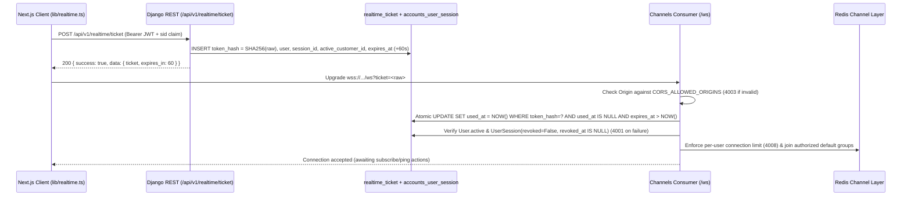

# Realtime WebSocket Architecture (`/ws` + `/api/v1/realtime/ticket`)

> Covers Django Channels (`apps/realtime`), ASGI runtime (`Daphne`), Redis channel layer, security controls, topic ACLs, durable outbox delivery, and frontend integration (`frontend/lib/realtime.ts`, `frontend/docs/realtime.md`).

---

## 1. End-to-End Connection & Authentication Flow

Because browser `WebSocket` APIs cannot attach custom `Authorization` headers during the upgrade handshake, passing bearer JWTs in `?token=` URLs would leak long-lived credentials into HTTP access logs and browser history. Project-2 uses a **single-use handshake ticket**:

- **Mock Compatibility Preserved**: In `frontend/lib/realtime.ts`, `resolveSocketUrl()` requests `POST /api/v1/realtime/ticket` when `USE_MOCK` is `false` and retains `?token=` only when `USE_MOCK` is `true` for the standalone Node mock server (`npm run realtime`).
- **Session Revocation Synchronization**: Logging out via `POST /api/v1/auth/logout` sets both `revoked = True` and `revoked_at` on `UserSession`, blocking ticket issuance and ticket redemption immediately.
- **Ticket Hygiene**: Periodic Celery task `realtime.cleanup_expired_tickets` (`cleanup_realtime_tickets_task`) runs every 15 minutes (`*/15`) to purge expired or consumed tickets older than 1 day.

---

## 2. ASGI Routing & Channel Layer

- **ASGI Entry Point** ([`backend/config/asgi.py`](file:///c:/Users/Administrator/Desktop/Alnahrian/backend/config/asgi.py)):
  - `"http"`: standard Django ASGI handler.
  - `"websocket"`: `URLRouter(websocket_urlpatterns)` routing `/ws` via `apps/realtime/routing.py`.
- **Docker / Process Server**: [`backend/Dockerfile`](file:///c:/Users/Administrator/Desktop/Alnahrian/backend/Dockerfile) and [`backend/docker-compose.yml`](file:///c:/Users/Administrator/Desktop/Alnahrian/backend/docker-compose.yml) run `daphne -b 0.0.0.0 -p 8000 config.asgi:application`.
- **Channel Layer (`config/settings/base.py`)**:
  - When `CHANNELS_REDIS_URL` (or `REDIS_URL`) is configured (e.g., `redis://redis:6379/3`), uses `channels_redis.core.RedisChannelLayer`.
  - When no Redis URL is configured in local development/testing, falls back to `channels.layers.InMemoryChannelLayer`.

---

## 3. Security Limits & WebSocket Close Codes

Implemented in [`backend/apps/realtime/consumers.py`](file:///c:/Users/Administrator/Desktop/Alnahrian/backend/apps/realtime/consumers.py) and configured via environment variables:

| Setting / Env Var | Default | Enforcement |
| --- | --- | --- |
| `REALTIME_TICKET_TTL_SECONDS` | `60` | Ticket expires after 60s; expired, used, or revoked-session tickets close with `4001`. |
| `CORS_ALLOWED_ORIGINS` (plus `CSRF_TRUSTED_ORIGINS` / same-host / debug localhost) | `http://localhost:3000,http://127.0.0.1:3000` | Mismatched WebSocket `Origin` header rejects before/at connect with close code `4003`. |
| `REALTIME_MAX_CONNECTIONS_PER_USER` | `5` | Exceeding concurrent active WebSocket connections per user closes newest connection with `4008`. |
| `REALTIME_MAX_MESSAGE_BYTES` | `16384` | Oversized client frames or binary frames close connection with `4009`. |
| `REALTIME_RATE_LIMIT_PER_10S` | `30` | Sliding 10-second inbound message counter sends `{"type": "error", "code": "RATE_LIMITED"}` and closes at `2x` limit with `4029`. |

JSON control error codes emitted on-wire without tearing down valid sessions (unless abusive): `RATE_LIMITED`, `FORBIDDEN`, `UNKNOWN_TOPIC`, `UNKNOWN_ACTION`, `INVALID_JSON`, `INVALID_PAYLOAD`, `VALIDATION`.

---

## 4. Topic ACLs & Group Fanout Architecture

Every client `subscribe` action is checked server-side in `_groups_for_topic(...)` per user role, warehouse assignment, rep identity, and session `active_customer_id`:

| Topic | Who Can Subscribe | Channel Groups Joined |
| --- | --- | --- |
| `notifications` | All authenticated active users | `user_<user_id>`, `role_<role>` |
| `chat` | `staff`, `manager`, and `shop` (with active shop); others denied `FORBIDDEN` | `staff`/`manager` -> `chat_staff`; `shop` -> `shop_<active_customer_id>` |
| `orders` | `manager`, `accountant`, `warehouse`, `staff`, `rep`, `shop` | `manager`/`accountant` -> `role_<role>`; `warehouse`/`staff` -> `wh_<warehouse_id>`; `rep` -> `user_<user_id>`; `shop` -> `shop_<active_customer_id>` |
| `location` | `manager`, `accountant`, `warehouse`, `staff`, `rep`, `shop` | `manager`/`accountant`/`warehouse`/`staff` -> `loc_staff`; `rep` -> `user_<user_id>`; `shop` -> `shop_<active_customer_id>` |

### Domain Event Broadcast & Durable Outbox Safety
- **Transactional Outbox (`OutboxEvent`)**: `enqueue_outbox_event()` in [`backend/apps/realtime/broadcaster.py`](file:///c:/Users/Administrator/Desktop/Alnahrian/backend/apps/realtime/broadcaster.py) persists `OutboxEvent` inside the active DB transaction and hooks `transaction.on_commit(...)` (`_wake_outbox_event`), ensuring uncommitted or rolled-back database transactions never leak WebSocket frames.
- **Atomic Lease, Retry Backoff & Dead-Letter**: `deliver_outbox_event()` atomically transitions due `PENDING` rows (or stale `PROCESSING` leases older than `OUTBOX_LEASE_SECONDS = 60`) to `PROCESSING`, invokes `dispatch_outbox_realtime(..., raise_on_error=True)`, retries transient failures with exponential backoff `min(300, 15 * 2^(attempts - 1))` seconds, and transitions exhausted rows to `OutboxStatus.FAILED` after `OUTBOX_MAX_ATTEMPTS = 5`. Celery task `notifications.process_outbox_events` sweeps due/stale rows every 1 minute.
- **Confidential Redaction Over WS**: Order/notification WebSocket payloads contain minimal wakeup metadata (`topic`, `type`, `data: { id, ... }`, `at`) and **never** include delivery `pin`, customer secrets, `avg_cost`, or `profit`.
- **Rep Live GPS via WS**: Delivery reps may publish `{ action: "publish", topic: "location", data: { lat, lng } }`. The consumer validates bounds, persists `RepLocation` via `record_rep_location(..., emit_realtime=False)`, and broadcasts `{ topic: "location", type: "moved", data: loc_dict, at }` strictly to `loc_staff` and `shop_<cid>` for customers that currently have an `"out"` delivery assigned to that rep. Other roles attempting `publish` on `location` receive `FORBIDDEN`.
